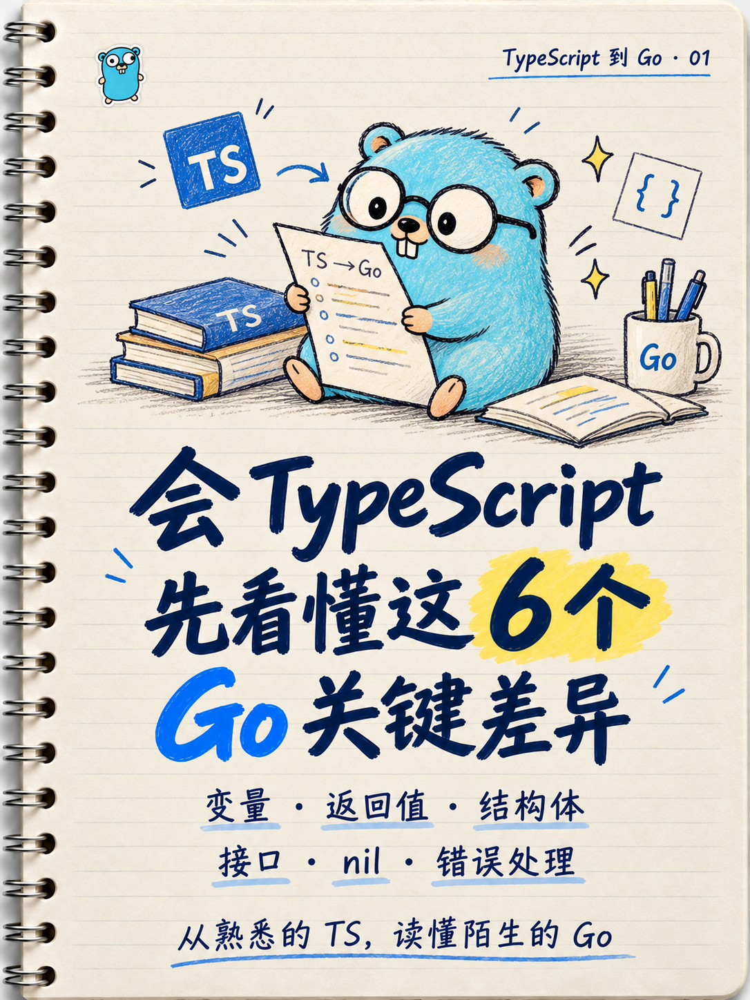
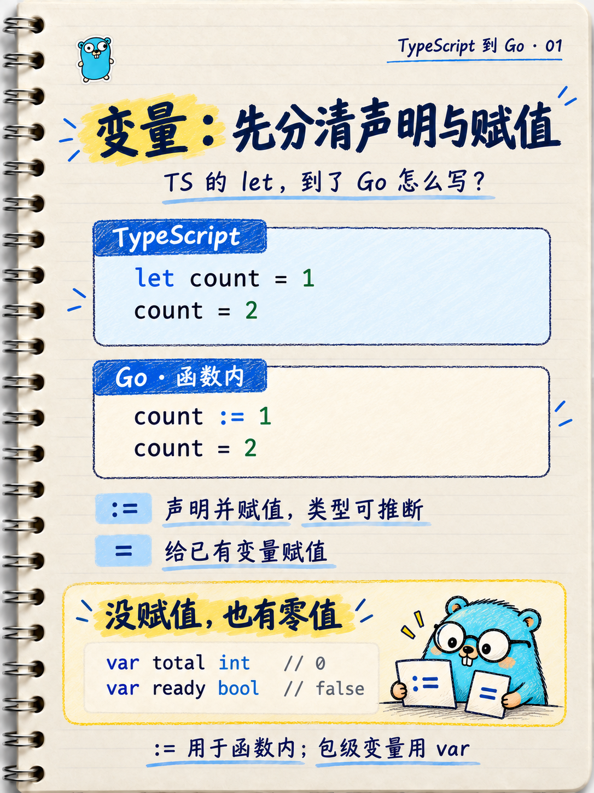

# Agent Skills

可复用的 AI 工作技能合集，由 [doraluo-007](https://github.com/doraluo-007) 维护。

## 技能目录

| Skill | 用途 |
| --- | --- |
| [notebook-tech-cards](./skills/notebook-tech-cards/SKILL.md) | 生成米白线圈笔记本风格的技术学习封面与正文配图，支持更换主题、Logo、吉祥物和配色。 |

## 线圈笔记本配图

米白横线纸、左侧金属线圈、深蓝手写标题、蓝黄重点标记。适合技术笔记、小红书封面和知识卡片。

| 封面参考 | 内页参考 |
| --- | --- |
|  |  |

参考图中的 TypeScript / Go 是示例主题。使用时会根据新主题调整内容、Logo、吉祥物与系列名。

## 安装到 Codex

克隆仓库：

```bash
git clone https://github.com/doraluo-007/agent-skills.git
cd agent-skills
```

把 `skills/notebook-tech-cards` 整个文件夹复制到你的 Codex skills 目录，默认是 `~/.codex/skills/`；设置过 `CODEX_HOME` 时使用该目录下的 `skills/`。

首次安装可以运行：

```bash
skill_dir="${CODEX_HOME:-$HOME/.codex}/skills"
mkdir -p "$skill_dir"
if [ -e "$skill_dir/notebook-tech-cards" ]; then
  echo "技能已存在，请先比较本地内容再更新。"
else
  cp -R skills/notebook-tech-cards "$skill_dir/"
fi
```

安装后在新会话中调用：

```text
用 $notebook-tech-cards 为 React Hooks 制作一组技术笔记配图，
沿用米白线圈笔记本风格，左上角换成 React Logo。
```

生成或编辑成图需要运行环境提供图像生成工具。只有文字模型时，可阅读技能并整理文案与提示词。

## 仓库结构

```text
skills/
└── notebook-tech-cards/
    ├── SKILL.md                 # 技能入口与工作流程
    ├── agents/openai.yaml      # Codex 展示信息
    ├── assets/                 # 封面与内页参考图
    └── references/             # 主题参数与提示词模板
```

新增技能时，在 `skills/<skill-name>/` 下建立独立目录，保留 `SKILL.md` 和实际需要的资源，并更新技能目录。

## 素材说明

参考图包含 Go Gopher 与技术标识，仅用作视觉示例。相关名称、标识与角色的权利归各自权利人；本仓库不声称与其有官方关联。
